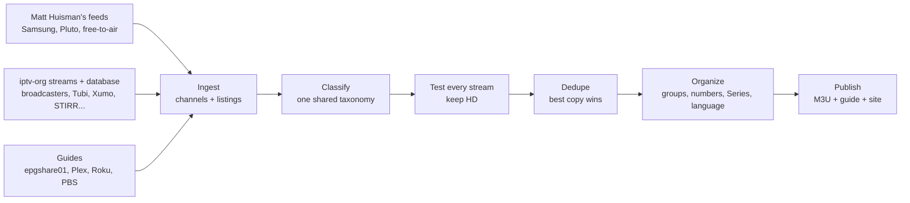

<picture>
  <source media="(prefers-color-scheme: dark)" srcset="docs/logo-dark.png">
  
</picture>

**The basic cable of IPTV.** The free, publicly available live channels for a country in one clean playlist, with a guide that's actually complete.

**[jordanmarshall-dev.github.io/openm3u.tv](https://jordanmarshall-dev.github.io/openm3u.tv/)**: pick your country, copy the playlist link into TiviMate (or any IPTV app), done.

There are thousands of free, ad-supported live channels out there, from streaming services like Samsung TV Plus and Pluto TV to broadcasters' own public streams. Community projects like iptv-org already list most of them, but those lists are long and unsorted: one per service, dozens of one-channel categories, dead links, duplicates, thin guides. Open M3U is the layer on top that organizes them into something that feels like a cable lineup:

- **Real channel numbers.** Local stations below 100, news at 100, sports at 200, movies at 300, and so on. A channel keeps its number from one build to the next.
- **Nothing broken.** Every stream is opened before it's listed: the playlist, its best variant, and a real video segment. Dead and copy-protected channels are dropped. Streams limited to their own country are checked from inside it.
- **HD only.** Anything that tops out below 720p is left out.
- **One copy of each channel.** When CBC News is on Samsung and Pluto, the better stream wins.
- **The same groups everywhere.** One shared set of categories maps what every source calls things ("News & Opinion", "News + Opinion", `news`) onto one lineup.
- **One-show channels on their own shelf.** Channels that loop a single show (Ink Master, Frasier, Corner Gas) move to an alphabetized Series group, so the genre groups feel like real channels.
- **English first.** Other languages sit together in their own block at the end (Canada's En français, the US's En español) instead of being mixed in.
- **A full guide.** Program titles, episode numbers, descriptions and art for every slot.

The lineup and guide rebuild every three hours, and every channel has listings for the next 48. Set your app to refresh the guide often (TiviMate: Settings, EPG, update interval) so it keeps rolling forward.

## Countries

| Country | Playlist | Highlights |
|---|---|---|
| Canada | [`ca.m3u`](https://jordanmarshall-dev.github.io/openm3u.tv/ca.m3u) | CTV News, CBC News Network, CBC and Global local news city by city, CityNews, CPAC, Corner Gas |
| United States | [`us.m3u`](https://jordanmarshall-dev.github.io/openm3u.tv/us.m3u) | ABC, CBS and NBC News, local stations, FOX Weather, NFL, MLB and NBA channels, Tubi, Xumo, STIRR, Roku, Plex, and an En español block |
| United Kingdom | [`uk.m3u`](https://jordanmarshall-dev.github.io/openm3u.tv/uk.m3u) | BBC One (every region), Two, Three, Four, CBBC, CBeebies, GB News, talkSPORT |
| Australia | [`au.m3u`](https://jordanmarshall-dev.github.io/openm3u.tv/au.m3u) | ABC, SBS, Seven, Nine and 10 on their usual numbers, plus their pop-up channels |
| New Zealand | [`nz.m3u`](https://jordanmarshall-dev.github.io/openm3u.tv/nz.m3u) | Three, Whakaata Māori, Sky Open, Bravo, Rush, eden |

Each playlist links its own guide (the same address ending in `.xml.gz`), so most apps load it automatically. Many streams only play in their own country, so pick yours.

## About these streams

Open M3U doesn't host, record, relay or modify any video. It's a curator, like iptv-org: the playlists are lists of links to streams that their owners publish for free, with their own ads, and your app plays each one directly from its owner.

- Channels that need a login, a subscription or copy protection (DRM) are never included.
- Nothing works around a channel's regional restrictions; many channels only play in their own country.
- iptv-org's blocklist, which covers channels removed at their owners' request, is always honoured.
- If you own or represent a channel and would rather it wasn't listed, [ask here](https://github.com/jordanmarshall-dev/openm3u.tv/issues/new?template=removal.yml) and it will be removed.

Open M3U isn't affiliated with or endorsed by any channel, network or streaming service. Channel names, logos and programme information belong to their respective owners. Each service's own terms of use still apply to how you watch it.

## How it works



| Stage | Module |
|---|---|
| Sources | [`sources/mjh.py`](src/openm3u/sources/mjh.py), [`sources/iptvorg.py`](src/openm3u/sources/iptvorg.py), [`sources/playlist.py`](src/openm3u/sources/playlist.py) |
| Guides | [`guide.py`](src/openm3u/guide.py) (reading), [`guides.py`](src/openm3u/guides.py) (matching channels to them) |
| Categories | [`taxonomy.toml`](src/openm3u/taxonomy.toml), [`taxonomy.py`](src/openm3u/taxonomy.py) |
| One-show detection | [`filters.py`](src/openm3u/filters.py) |
| Language | [`language.py`](src/openm3u/language.py) |
| Stream health | [`health.py`](src/openm3u/health.py), [`checks.py`](src/openm3u/checks.py) |
| Deduplication | [`dedupe.py`](src/openm3u/dedupe.py) |
| Groups and stable numbers | [`lineup.py`](src/openm3u/lineup.py), [`state.py`](src/openm3u/state.py) |
| Playlist, guide and site | [`output/`](src/openm3u/output), [`site.py`](src/openm3u/site.py) |

A [GitHub Actions workflow](.github/workflows/publish.yml) runs the whole thing every three hours and deploys the result to GitHub Pages.

**One taxonomy.** [`taxonomy.toml`](src/openm3u/taxonomy.toml) lists the groups every country shares, their numbers, and every label any source uses for them. A channel with no useful label is placed by what fills its guide, then by its name. Shopping, religious and adult channels are left out. `openm3u categories` lists any label the taxonomy doesn't know yet.

**Countries are config.** Each country is a TOML file in [`regions/`](src/openm3u/regions): its sources, guides, which channels go first, how places are ordered, and any group it renames (the UK's local block is "Freeview"). Adding a country is a new file, not new code.

**Picking from iptv-org.** Every relevant stream file is read (`us`, `us_local`, `us_tubi`, `us_xumo`, `uk_distro` and dozens more), with iptv-org's database supplying each channel's category, language and broadcast area. A channel serving one city or province is a local station. Channels named in a region's `include` list are always carried; the long tail needs a guide to make it in.

**Spotting one-show channels.** Each channel's schedule is grouped by series and weighted by airtime. If the channel is named after its top show, 80% of airtime is enough, and spin-offs count toward the show. Otherwise it needs 95% over at least 36 hours, so a comedy channel running a marathon today stays put. News, sports and music are exempt.

**Stable numbers.** A channel keeps the number it had last time if it's still in the right group. Numbers of channels that disappear are held for 30 days. A group that outgrows its hundred continues 2000 higher (Entertainment runs 400 to 499, then 2400 on), so nothing ever shifts. The state file is published alongside the site, so a fresh build server picks up where the last one left off.

**Testing from the wrong country.** The builder runs on GitHub's US servers. A Canadian stream that answers "forbidden" from there is usually limited to Canada rather than dead, so it's kept as unverified. Running `openm3u verify ca` from inside Canada tests every stream there and writes [`checks/ca.json`](checks/); once that's committed, builds drop what failed and mark what played as checked.

## Run it yourself

```sh
pip install git+https://github.com/jordanmarshall-dev/openm3u.tv
openm3u build --region ca
```

This writes `output/ca.m3u` and `output/ca.xml.gz`. Copy [`openm3u.example.toml`](openm3u.example.toml) to `openm3u.toml` to hide channels, pin numbers, move channels between groups, or turn the Series and language grouping off. Set `TMDB_API_KEY` for TMDB artwork.

| Command | What it does |
|---|---|
| `openm3u build --region ca` | Build one country into `output/` |
| `openm3u publish --region ca --site site` | Build into the public site folder |
| `openm3u verify ca` | Test a published playlist from where you are, save `checks/ca.json` |
| `openm3u categories --region us` | List source labels the taxonomy doesn't map |
| `openm3u probe <url>` | Test one stream |

## Credits

Channel data from [Matt Huisman's feeds](https://github.com/matthuisman/i.mjh.nz), whose `jmp2.uk` service hands out fresh stream links for Samsung TV Plus and Pluto TV, and from [iptv-org](https://github.com/iptv-org/iptv) and its [database](https://github.com/iptv-org/database). Guides from [epgshare01](https://epgshare01.online) and Matt's Plex, Roku and PBS guides. Logos from [tv-logos](https://github.com/tv-logo/tv-logos). Optional artwork from [TMDB](https://www.themoviedb.org); this product uses the TMDB API but is not endorsed or certified by TMDB.

## Development

```sh
pip install -e ".[dev]"
pytest
ruff check . && ruff format --check .
```

Tests run against trimmed copies of the real feeds in `tests/fixtures`, so they don't touch the network. For a full offline build, clone `matthuisman/i.mjh.nz`, `iptv-org/iptv` and `iptv-org/database` and point `[mirrors]` in your config at them (see the example config).

## License

The code is MIT licensed. That covers the software only, not the channels, streams, logos or guide data the playlists point to, which belong to their owners.
